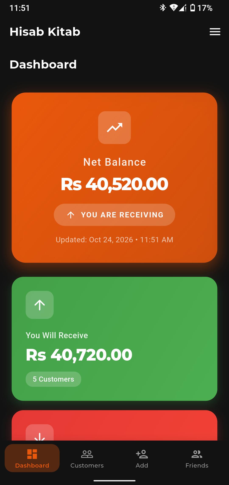
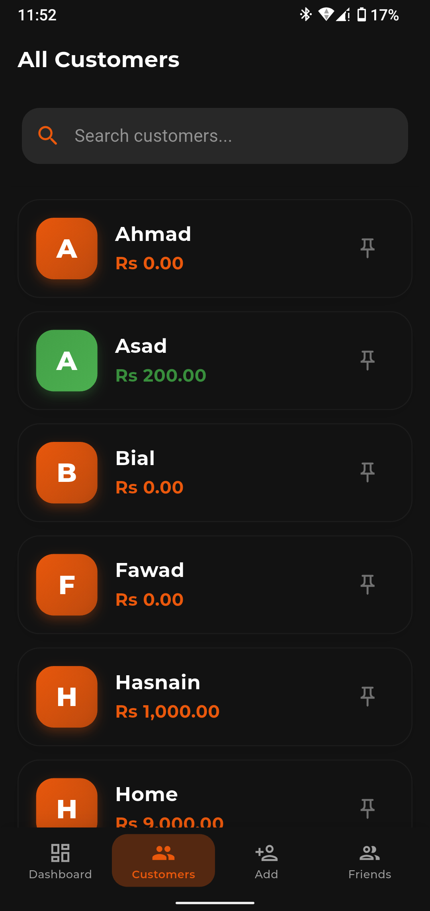
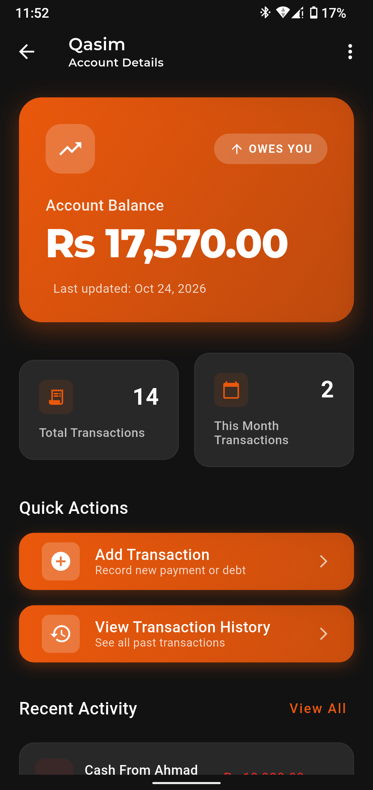
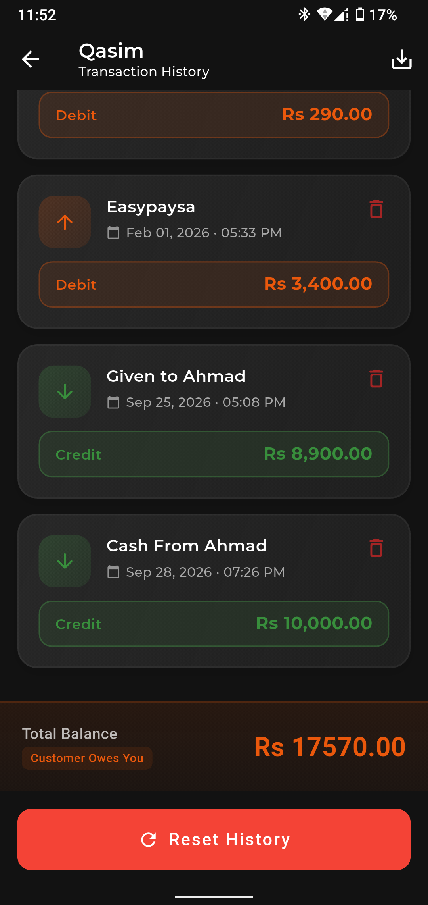
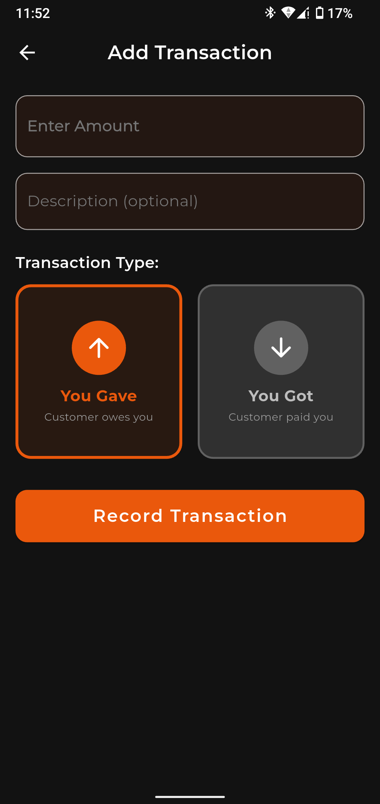
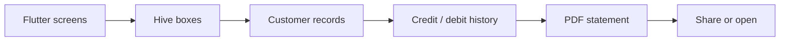

<p align="center">
  
  
  
</p>

# Hisab Kitab

A local-first Flutter ledger for small shops to track customer balances, record money given or received, and export transaction history.

**Flutter · Dart · Hive · PDF · Share Plus · FlexColorScheme**

## Product tour

| Transaction history | Add a transaction |
| --- | --- |
|  |  |

## What is included

- A balance dashboard with totals for money to receive and money to pay.
- Searchable customer accounts with pinning and balance indicators.
- Credit and debit transactions with descriptions and timestamps.
- Per-customer history, transaction deletion, and history reset controls.
- PDF generation and sharing for customer statements.
- Local persistence with Hive and saved light/dark theme preferences.

The checked-in Flutter source stores its ledger on the device. It does not currently call the separate [Django backend](https://github.com/Imranxhah/hisab_kitab_django_backend). The supplied screenshots also show a Friends navigation item that is not implemented in this repository's current source.

## Get started

Use a Flutter SDK with Dart 3 support.

```bash
git clone https://github.com/Imranxhah/hisab_kitab.git
cd hisab_kitab
flutter pub get
flutter run
```

Data is created locally on first use. No API keys or server configuration are required for the checked-in version.

## How it works



| Location | Responsibility |
| --- | --- |
| [lib/main.dart](lib/main.dart) | Hive setup, shop setup flow, navigation, and theme state |
| [lib/home_page.dart](lib/home_page.dart) | Balance summary and customer insights |
| [lib/customer_list_page.dart](lib/customer_list_page.dart) | Search, sorting, pinning, and customer selection |
| [lib/customer_detail_page.dart](lib/customer_detail_page.dart) | Customer balance and account actions |
| [lib/transaction_history_page.dart](lib/transaction_history_page.dart) | History, PDF export, sharing, deletion, and reset |
| [lib/app_theme.dart](lib/app_theme.dart) | Shared light and dark themes |

## Development

```bash
flutter analyze
flutter test
```

The current widget test is still the default counter test and should be replaced with ledger-specific coverage.

No license file is included. Contact the owner to clarify reuse terms.

Built by [Imran Shah](https://github.com/Imranxhah).
